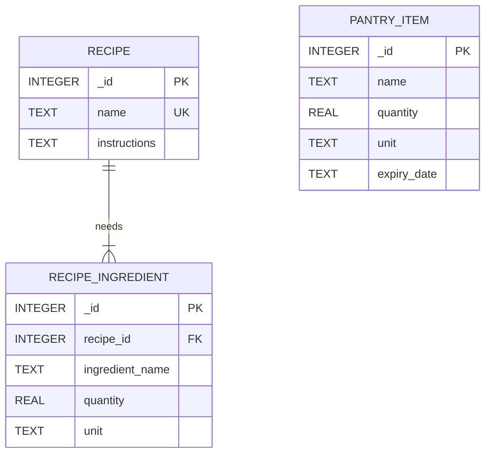

# Smart Pantry Manager

An Android application that helps reduce household food waste. Users record the ingredients they already have at home, and the app suggests recipes they can cook with exactly those ingredients.

Built for the Mobile App Development 700 practical assignment.

**Author:** Sihle Mahlangu

## The key rule: strict recipe matching

A recipe appears in Suggested Recipes only when **every** required ingredient is in the pantry in a large enough quantity. Recipes with a missing ingredient, too little quantity, or units that cannot be compared reliably are never shown. There are no partial matches.

## Features

| Feature | Details |
|---------|---------|
| Pantry management | Add, view, edit and delete ingredients with a name, quantity, unit and optional expiry date |
| Input validation | Blank names, names without letters, zero, negative, huge or non-numeric quantities and missing units are rejected with a message on the field |
| Multi-select delete | Press and hold an ingredient to select several, then delete them together |
| Recipe collection | 20 built-in recipes stored in SQLite and seeded once |
| Strict matching | Name normalization, unit conversion and quantity checks (see below) |
| Suggested Recipes | Shows only recipes that can be made right now, with a helpful message when there are none |
| Recipe details | Ingredients with quantities and numbered preparation steps |
| Expiry alerts | Items that are expired or expiring soon are highlighted, with a summary banner |
| Settings | Alerts on or off, how many days counts as "soon", and whether expired items are ignored in suggestions. Saved with SharedPreferences |
| Navigation | Home cards plus a toolbar menu on every main screen, using explicit Intents |
| Persistence | Pantry data is stored in SQLite, so it is kept when the app is closed and reopened |

## Technology

| Area | Choice |
|------|--------|
| Language | Java only |
| IDE | Android Studio |
| UI | XML layouts, Activities, RecyclerView with custom Adapters, Material Components |
| Database | SQLite through SQLiteOpenHelper |
| Settings storage | SharedPreferences |
| Navigation | Explicit Intents and a toolbar menu |
| Minimum Android version | API 26 (Android 8.0) |
| Build | Android Gradle Plugin 8.5.2, Gradle 8.7 |

## Requirements

- Android Studio (a recent stable version)
- JDK 17 or 21. Use the JDK bundled with Android Studio. Gradle 8.7 does not support JDK 22 or newer.
- An emulator or device running Android 8.0 (API 26) or higher

## How to run

1. Clone the repository:
   ```
   git clone https://github.com/Dev-Sihle-Mahlangu/SmartPantryManager.git
   ```
2. In Android Studio choose **Open** and select the `SmartPantryManager` folder.
3. Wait for the Gradle sync to finish. The first sync needs an internet connection.
4. If Android Studio reports an incompatible Gradle JVM, open **Settings > Build, Execution, Deployment > Build Tools > Gradle** and set **Gradle JDK** to a JDK 17 or 21.
5. Choose an emulator or connected device and press **Run**.

## Testing

- **JVM unit tests** (`app/src/test`) cover the validation rules, the ingredient name normalizer, the unit converter, the strict recipe matcher, the expiry rules and the built-in recipe data. They run without a device. To run them, right-click `app/src/test` in Android Studio and choose **Run Tests**.
- **Manual testing:** the app was run in the Android Studio emulator. A checklist of manual tests is in `docs/TEST_LOG.md`.

## Project structure

```
app/src/main/java/com/smartpantry/manager/
    activities/
        MainActivity              Home screen
        BaseNavigationActivity    Shared toolbar and navigation menu
        PantryActivity            Pantry list, expiry banner, multi-select delete
        AddEditPantryActivity     Add and edit form with validation
        SuggestedRecipesActivity  Recipes that can be made right now
        RecipeDetailActivity      One recipe in full
        SettingsActivity          Saved preferences
    adapters/
        PantryAdapter             Pantry RecyclerView adapter, expiry colours, selection
        RecipeAdapter             Recipe RecyclerView adapter
    database/
        PantryDbHelper            SQLiteOpenHelper: schema, upgrades and all queries
        RecipeSeeder              Inserts the built-in recipes once
        SeedRecipes               The 20 built-in recipes
    models/
        PantryItem, Recipe, RecipeIngredient
    utils/
        RecipeMatcher             Strict matching algorithm
        IngredientNormalizer      Name normalization
        UnitConverter             Supported units and conversions
        PantryValidator           Form validation rules
        ExpiryUtils               Expired and expiring soon calculations
        AppSettings               SharedPreferences wrapper
        FormatUtils               Number formatting
app/src/main/res/                 Layouts, menu, strings, colours and theme
app/src/test/                     JVM unit tests
docs/                             Checklists, test log and Git guides
```

## Database design

The app uses one SQLite database, `smart_pantry.db`, managed by `PantryDbHelper` (schema version 2).



- `recipe_ingredient.recipe_id` is a foreign key to `recipe._id` with `ON DELETE CASCADE`, and foreign keys are switched on in `onConfigure`.
- `pantry_item` has no foreign key to the recipe tables on purpose. A pantry ingredient and a recipe ingredient are matched by their normalized name in code, because a user can type any name.
- Quantities have a `CHECK(quantity > 0)` constraint, so invalid data cannot be stored even if validation is bypassed.
- **Seeding:** the 20 recipes are inserted when the database is created, and also when upgrading from version 1. The seeder does nothing if any recipe already exists, and recipe names are `UNIQUE`, so restarting the app never duplicates recipes.
- **Upgrades:** `onUpgrade` never drops tables, so upgrading from version 1 is designed to keep existing pantry data and add the recipe tables.

**Why SQLite:** the data is structured and related (recipes have many ingredients), it needs to be saved on the device and queried, and SQLite is built into Android with no extra setup, server or dependency. SharedPreferences is used only for the three small settings values.

## Strict recipe matching

`RecipeMatcher` decides which recipes appear in Suggested Recipes. A recipe qualifies only if every ingredient passes all of these checks. One failure rejects the whole recipe.

1. **Name:** names are lower-cased, punctuation and extra spaces are removed, and the last word is made singular, so "Tomatoes" in the pantry matches "tomato" in a recipe.
2. **Units:** quantities are converted to a base unit (grams, millilitres or pieces), so 1000 g equals 1 kg. Mass, volume and count units are never compared with each other, so grams never equal millilitres and pieces never equal grams.
3. **Quantity:** the combined pantry amount must be at least what the recipe needs. Duplicate pantry entries of the same ingredient are added together.

Suggestions are recalculated every time the screen is shown, so they always reflect the latest pantry and settings. The matching code has no Android dependencies, so it is covered by plain JVM unit tests.

## Settings

Three preferences are stored with SharedPreferences and survive restarting the app:

- Expiring soon alerts on or off
- How many days ahead counts as "expiring soon" (1, 2, 3, 5 or 7)
- Whether expired items are ignored when suggesting recipes (off by default)

<!--
## Screenshots

Uncomment this section after adding real screenshots to docs/screenshots (see the table there for file names).

| Home | My Pantry | Suggested Recipes |
|------|-----------|-------------------|
|  |  |  |
-->

## Known limitations

- Database calls run on the main thread. This is acceptable for the small amount of data here, but a larger app would move them to a background thread.
- Recipes are built in and cannot be added or edited inside the app.
- Settings changes apply the next time a screen is shown, not live on screens that are already open.

## Development history

The project was built in phases, each committed as it was completed. See the commit history for the real sequence of changes, and `docs/IMPLEMENTATION_CHECKLIST.md` for the status of every requirement.